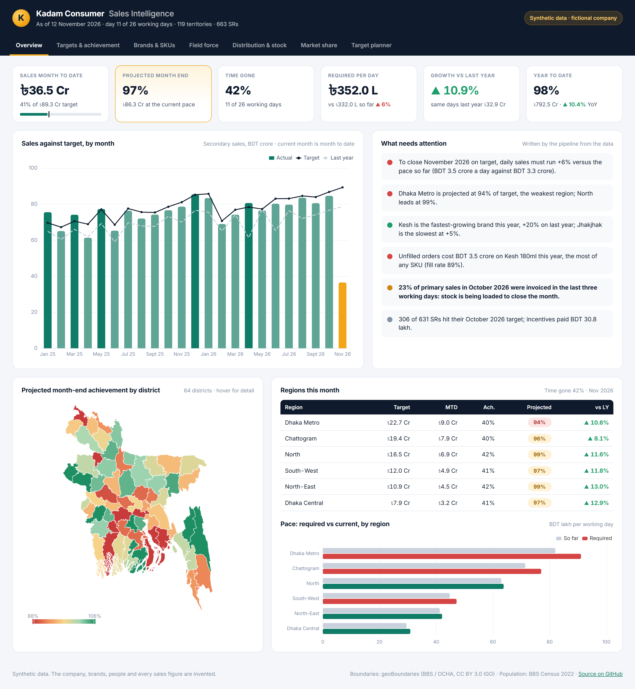
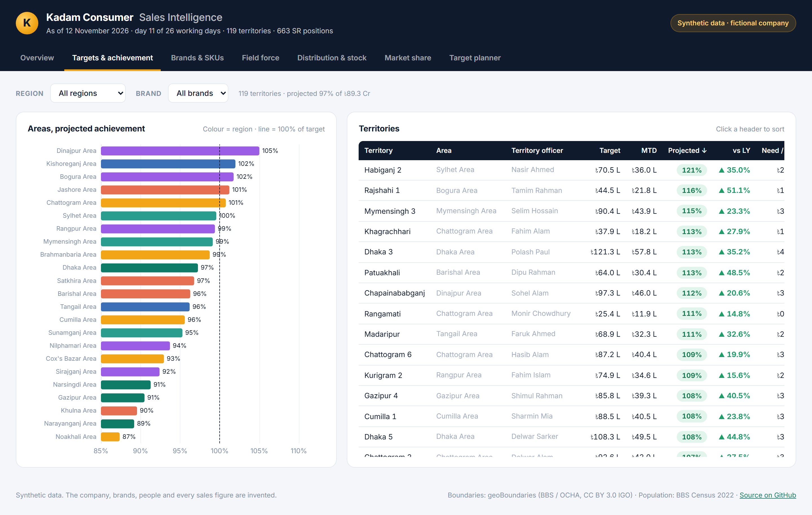
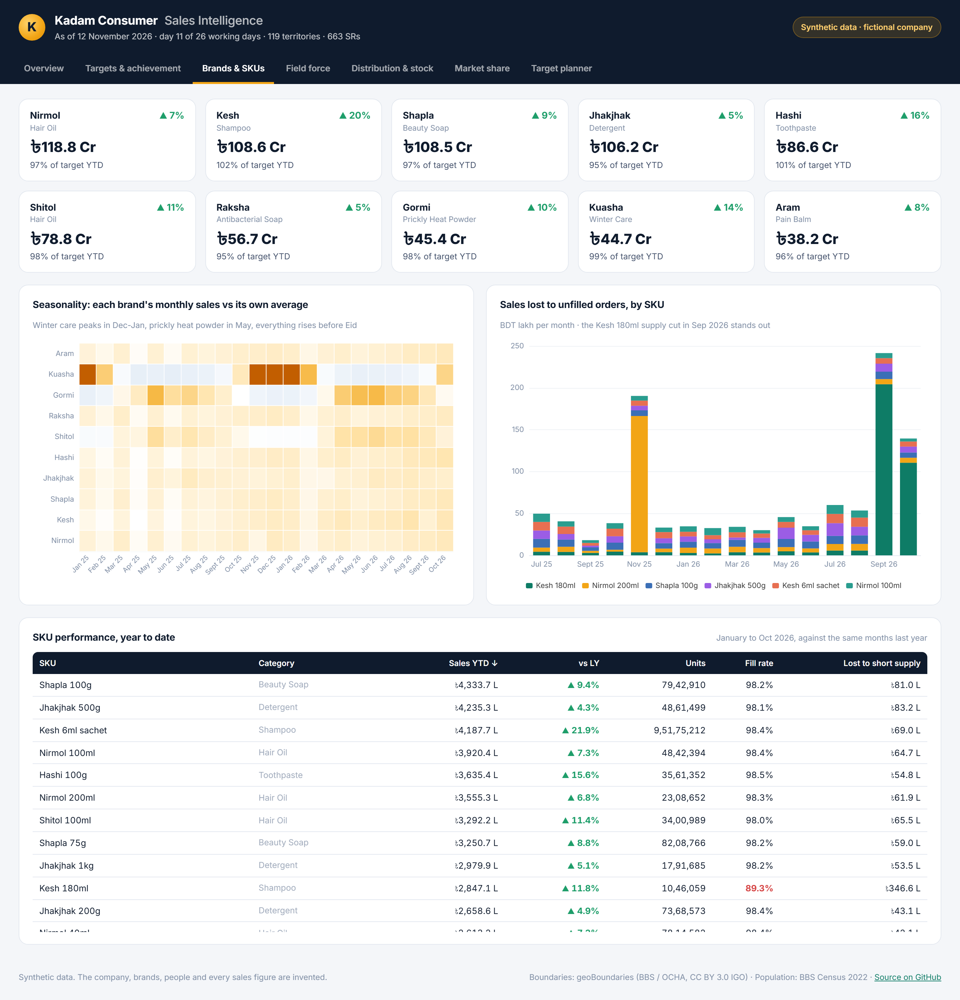
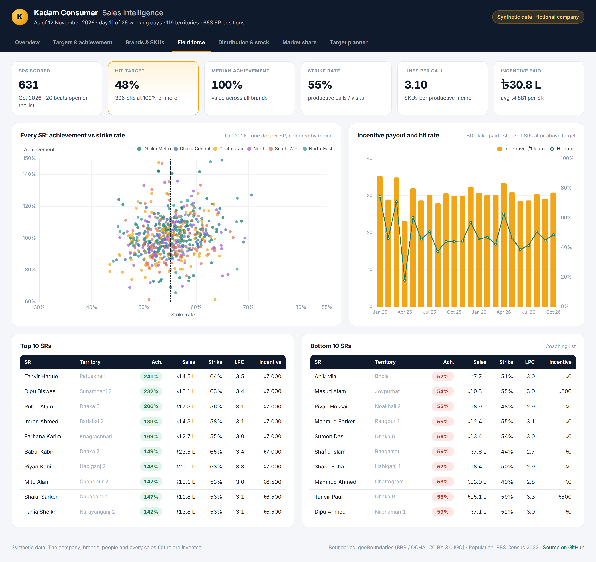
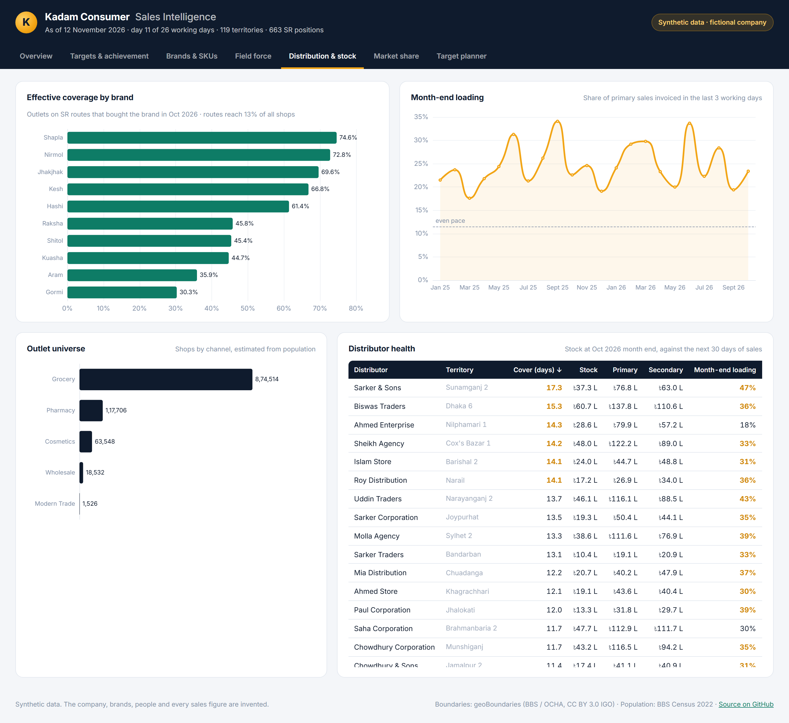
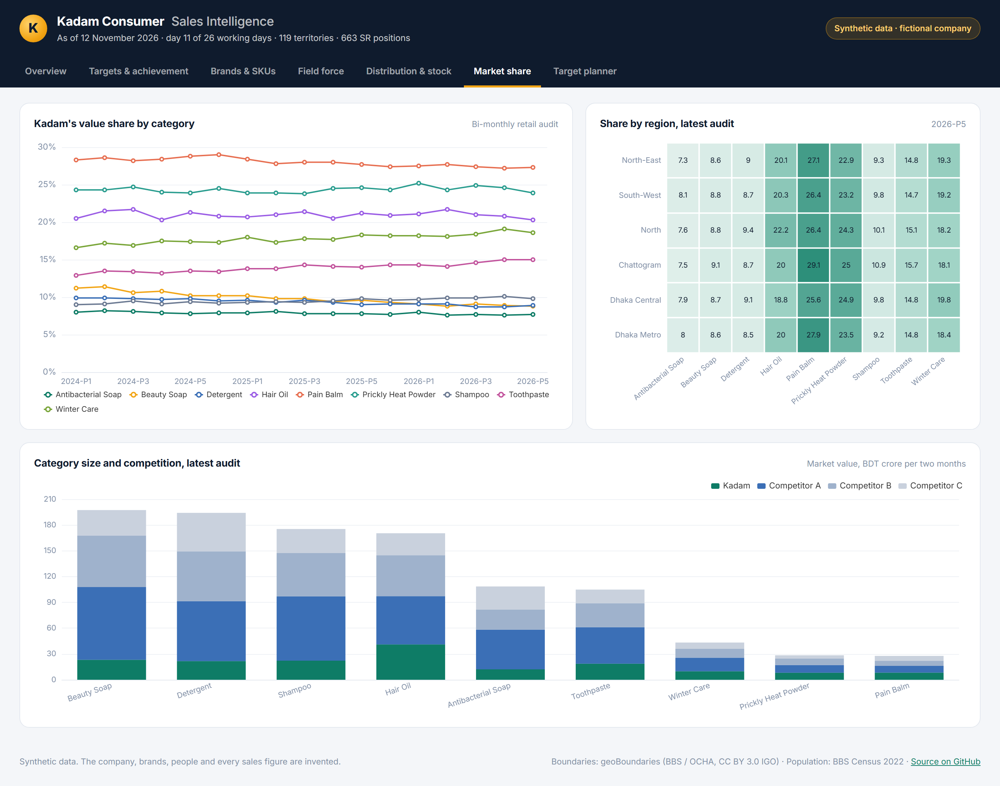
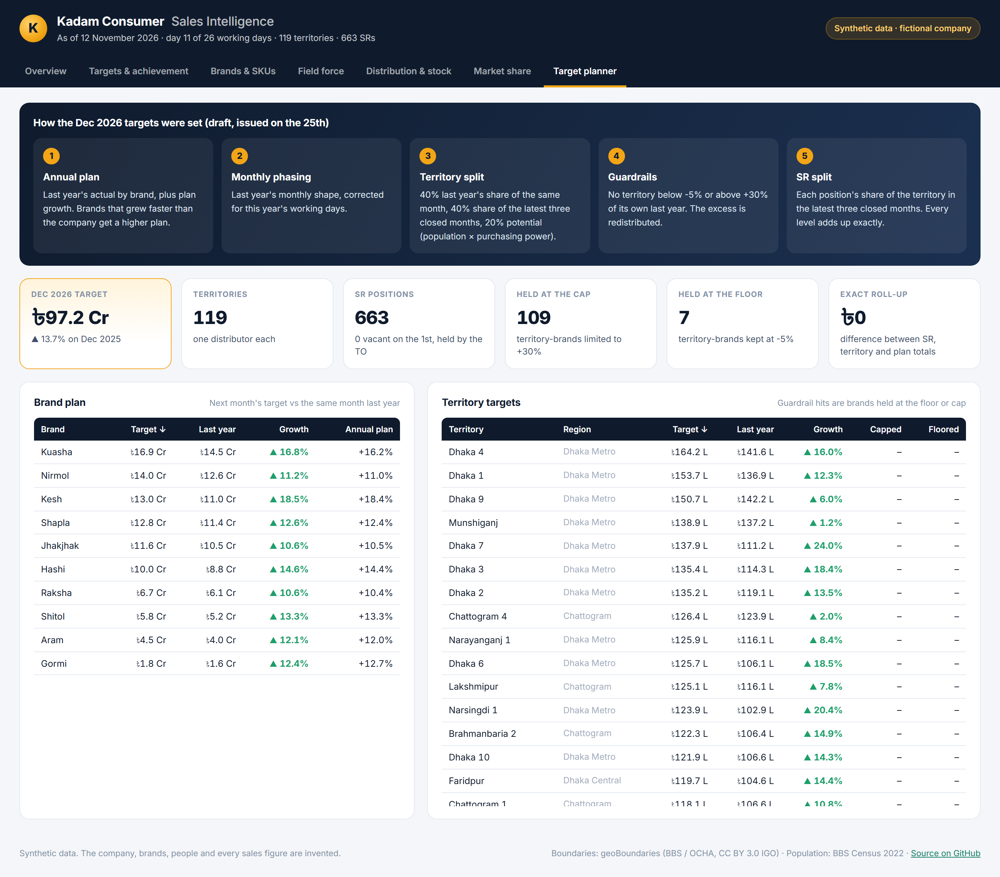

# Bangladesh FMCG Sales Intelligence

**An end-to-end sales system for a national FMCG company in Bangladesh: from distributor and SR data to monthly targets, achievement tracking, incentives and a management dashboard.**

All company data is synthetic. Kadam Consumer Ltd., its brands, people and sales figures are invented. The geography is real: all 64 districts, weighted by the 2022 census, with real Eid dates and seasons shaping demand.

**[Open the live dashboard](https://zubayerojhor.github.io/bd-fmcg-sales-intelligence/)**



---

## What it covers

| Sales analytics need | Where it lives |
|---|---|
| Monthly targets from the annual plan down to region, territory and each SR | [`targets.py`](src/fmcg_bd/targets.py), the **Target planner** tab |
| Target vs achievement, time gone, projected month end, required run rate | `marts.mtd_territory_brand`, **Overview** and **Targets** tabs |
| SR performance and incentive payout | `marts.sr_scorecard`, **Field force** tab |
| Brand and SKU growth, seasonality, pack mix, sales lost to short supply | **Brands & SKUs** tab |
| Distribution: effective coverage, outlet universe by channel | **Distribution & stock** tab |
| Distributor health: stock cover, primary vs secondary, month-end loading | **Distribution & stock** tab |
| Market share from a retail audit, by category and region | **Market share** tab |
| Data you can trust: 8 checks gate every build, 14 tests in CI | [`checks.py`](src/fmcg_bd/checks.py), [`tests/`](tests) |

## The business in numbers

| | |
|---|---|
| Coverage | 6 regions, 23 areas, 119 territories across all 64 districts |
| Route to market | 119 distributors, 663 SR positions, about 1.07M shops in the outlet universe |
| Portfolio | 10 brands in 9 categories, 35 SKUs, from a BDT 5 shampoo sachet to a 2kg detergent |
| History | 1 January 2024 to 12 November 2026, about 11 million rows |
| Scale | About BDT 880 crore of secondary sales a year |

## How it works

```mermaid
flowchart LR
  subgraph Sources["Source systems (simulated)"]
    ERP["ERP<br/>primary invoices"]
    DMS["DMS<br/>shop deliveries, SR sales,<br/>calls, stock counts"]
    SFA["Outlet census<br/>and coverage"]
    AUD["Retail audit<br/>market share"]
  end
  REF["Real reference data<br/>64 districts, census 2022,<br/>boundaries, Eid dates"] --> SIM
  SIM["Route-to-market<br/>simulator"] --> Sources
  Sources --> STG["DuckDB staging<br/>typed, priced, keyed"]
  STG --> MART["Sales marts<br/>territory x brand x month,<br/>SKU, SR, stock cover"]
  MART --> TGT["Target engine<br/>plan → month → territory → SR"]
  TGT --> PERF["Performance marts<br/>achievement, MTD,<br/>SR scorecard + incentive"]
  PERF --> CHK{"8 data checks"}
  CHK -->|pass| EXP["Export + written insights"] --> DASH["Dashboard<br/>GitHub Pages"]
```



**1. The simulator** ([`generate/`](src/fmcg_bd/generate)) plays out every working day for every territory and SKU:
- **Demand** comes from population and purchasing power, then season, Eid, price increases (with elasticity) and the brand's trend.
- **Distributors** hold a few days of stock, reorder once or twice a week, and sometimes run short of cash. When the shelf is empty the sale is lost, and the system records the order as unfilled.
- **Month-end loading:** in the last three working days of each month, the company pushes extra stock to close its own number.
- **Field force:** SRs leave, beats sit empty, and new SRs ramp up.
- **Shocks:** a flood, a transport strike and a plant supply cut leave visible marks in the data.

**2. The warehouse** ([`sql/`](sql)) is plain DuckDB SQL in two layers:
- **Staging** types every source table and prices it from the price list in force that day.
- **Marts** hold the grains people actually read.

**3. The target engine** ([`targets.py`](src/fmcg_bd/targets.py)) sets every month's targets the way a sales operations team would. The full method is in [docs/target_method.md](docs/target_method.md).
1. The annual plan is last year plus growth, with faster-growing brands asked for more.
2. Phasing follows last year's monthly shape, corrected for working days.
3. Territory split is 40% last year, 40% recent momentum, and 20% potential.
4. Guardrails keep each territory between -5% and +30% of its own last year.
5. The SR split follows each beat's share. Every level adds up to the taka.

**4. Data checks** ([`checks.py`](src/fmcg_bd/checks.py)) must all pass before the dashboard data is written:
- unique keys
- value equals units times price
- deliveries never exceed orders
- no negative stock
- SR sales tie to distributor sales on every territory, brand and day
- SR targets add up to territory targets
- targets sit inside the guardrails
- every territory has a target for every brand

**5. The dashboard** ([`dashboard/`](dashboard)) is a static page with ECharts, reading one JSON file. It has seven tabs, and the pipeline writes its own findings ("To close November on target, daily sales must run +6% versus the pace so far").

## Screens

| | |
|---|---|
|  |  |
|  |  |
|  |  |

## Run it

```bash
pip install -e ".[dev]"
python -m fmcg_bd all          # generate (~40 s), build the warehouse with checks (~2 min), export
python -m http.server -d dashboard 8000   # then open http://localhost:8000
pytest -q                      # 14 tests, including an end-to-end run on one region
```

Set `FMCG_AS_OF=2026-06-30` to rebuild the whole system as of another day.

## Project layout

```
data/reference/      real public data: districts, census population, boundaries
src/fmcg_bd/
  config.py          the fictional company: brands, SKUs, prices, regions, seasons, Eid dates
  generate/          the route-to-market simulator (org, catalogue, daily sales)
  targets.py         the target engine
  checks.py          data checks that gate the build
  export.py          dashboard data and written insights
sql/staging, sql/marts   the warehouse, in DuckDB SQL
dashboard/           the static dashboard (HTML, CSS, JS, data)
docs/                method, data model and KPI definitions
```

## What is real and what is invented

- **Real:** district names, centroids and boundaries, census population, the eight divisions, Eid ul-Fitr and Eid ul-Adha dates, national holidays, and the seasonal patterns of the categories.
- **Invented:** the company, every brand and SKU name, prices, people, distributors, sales, targets, competitors and market shares. Any resemblance to a real company is not intended.

## Sources and credits

- District centroids and Bangla names: [nuhil/bangladesh-geocode](https://github.com/nuhil/bangladesh-geocode)
- Population (Census 2022) and area: Bangladesh Bureau of Statistics, via Wikipedia's [Districts of Bangladesh](https://en.wikipedia.org/wiki/Districts_of_Bangladesh)
- District boundaries: [geoBoundaries](https://www.geoboundaries.org/) BGD ADM2 (BBS / OCHA, CC BY 3.0 IGO)

Built by [Md. Zubayer](https://www.linkedin.com/in/zubayer-ojhor) with AI pair-programming (Claude). MIT licence.
